# 🌾 AgriWatch: Solution Pitch

**🌐 Live app:** **[agri-watch-eight.vercel.app](https://agri-watch-eight.vercel.app)**

**🎬 Demo video (2 min):** **[Watch on Google Drive](https://drive.google.com/file/d/1WOFM06ZWQADyjP9vZlHh9ov3pcFgDlvs/view?usp=sharing)**. Live Hindi and Marathi voice calls, powered by Gnani Prisma and Timbre.

Built for the Gnani.ai Great Indian AI Internship Challenge

### The problem
Most Indian farmers sell their harvest without knowing the day's fair price. The government publishes daily mandi prices and the official MSP (Minimum Support Price), but in English, in tables and online. For a farmer at the mandi gate, that information is out of reach, so the trader's first offer often decides the price.

### The solution
**AgriWatch is a voice assistant farmers can simply talk to, in their own language.** A farmer asks, *"गाज़ियाबाद में चावल का आज का भाव क्या है?"*, and hears the answer within seconds: *"आज गाज़ियाबाद (हापूर मंडी) में चावल का भाव ₹4504 प्रति क्विंटल है।"*

- **10 Indian languages:** Hindi, Marathi, Tamil, Telugu, Bengali, Gujarati, Kannada, Malayalam, Punjabi and English. Both the voice and the whole screen switch.
- **Live mandi prices** from official government data (data.gov.in / Agmarknet).
- **Below-MSP warning**, using the official 2026-27 MSP list for all 22 notified crops.
- **The 5 nearest mandis**, ranked by best rate.
- **Hold-or-sell advice:** weighs storage cost against the price trend.
- **Honest by design:** if today's price isn't uploaded yet, it says so and offers nearby mandis or the MSP instead. Every number comes from a government source, never from the AI.

### Gnani AI models: what we use, and how
| Gnani model | What it does in AgriWatch | How it is applied and implemented |
|---|---|---|
| **Gnani Prisma**, speech-to-text (`vachana-stt-v3`) | Turns the farmer's spoken question into text in their language | Runs inside the LiveKit voice agent (`voice_engine/livekit_worker.py`) through the official `livekit-plugins-gnani` plugin. The language the farmer picks in the app is passed into the call and mapped to one Prisma locale (`hi-IN`, `mr-IN`, … in `agents/i18n.py`). Audio is 16 kHz, and Silero VAD detects when the farmer stops speaking before each utterance is sent for recognition. |
| **Gnani Timbre v2.5**, text-to-speech | Speaks every reply back in a natural Indian voice | Configured as the agent's voice (`model="timbre-v2.5"`, voice **Pranav**, `language` = the farmer's language). It voices the greeting, "checking the records" fillers while data loads, the answer itself and the inactivity check, in all 10 languages. The demo video also uses Timbre for the narrator (**Kaveri**) and the farmer (**Deepak**). |

### How a question flows
**Farmer speaks** → LiveKit (real-time call) → Silero VAD → **Gnani Prisma** (speech → text) → LangGraph agent (guardrail → Groq LLM choosing a price, MSP, nearby-mandi or hold-or-sell tool → backup path if the LLM is down) → official data → **Gnani Timbre v2.5** (text → speech) → **farmer hears the answer**.

### Where it runs
- **Website and API** on **Vercel**, Mumbai region: [agri-watch-eight.vercel.app](https://agri-watch-eight.vercel.app). This covers the dashboard, the MSP list and text chat in 10 languages.
- **The voice agent** is a long-running LiveKit worker (`run_local.sh`), because Vercel functions are short-lived. Voice calls on the website connect when the worker is running.

### Why it matters
It lets a farmer check the rate, spot a below-MSP offer and find a better mandi **before** selling, using only their voice and their own language. No reading, no typing and no English needed.

---

# 🌾 Agri_watch - Sovereign Indic Agricultural Voice Intelligence Agent

[](https://www.python.org/downloads/)
[](https://github.com/langchain-ai/langgraph)
[](https://groq.com/)
[](https://livekit.io/)
[](https://gnani.ai/)

**Agri_watch** is a production-grade, voice-first AI agent designed for Indian farmers and rural traders. It enables effortless, natural Hindi voice interaction over WebRTC to discover **live APMC Mandi wholesale prices**, calculate **multi-mandi transport arbitrage**, analyze **7-day price trends**, and verify **Government MSP (Minimum Support Price) floor protections**.

---

## 🏗️ System Architecture

Agri_watch decouples real-time audio streaming from cognitive deliberative reasoning using an event-driven architecture:

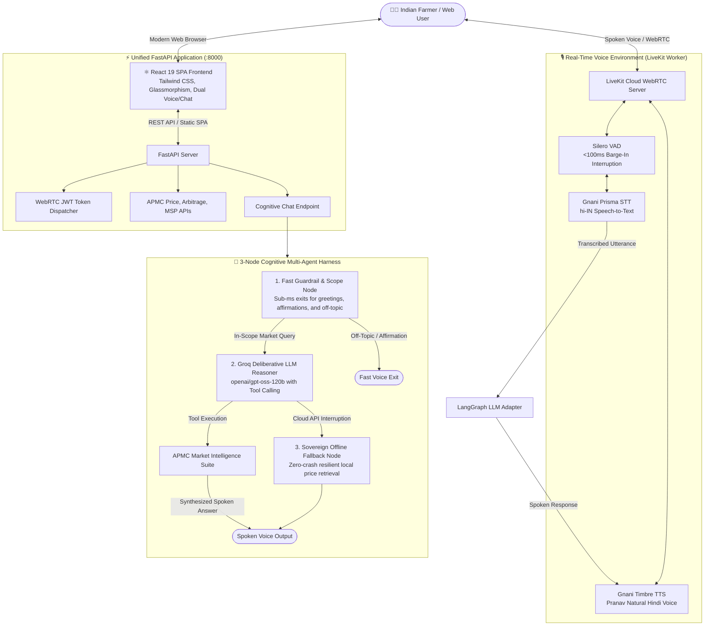

### 🛠️ Market Intelligence Suite (Agent Tools)
1. **`get_crop_price_tool`**: Fetches date-specific APMC modal wholesale rates. If today's rates have not yet been posted by the mandi, it chronologically scans and retrieves the nearest available date.
2. **`compare_mandi_arbitrage_tool`**: Compares commodity rates across multiple APMC markets within a district, adjusting for estimated diesel/freight costs ($\approx ₹35/\text{km}$) to recommend where the farmer will net the highest profit.
3. **`check_msp_floor_tool`**: Looks up official CACP (Commission for Agricultural Costs and Prices) Minimum Support Price floor benchmarks.
4. **`get_crop_price_trend_tool`**: Analyzes 7-day price movement and momentum (Rising, Falling, Stable) to guide whether to sell now or wait.

---

## 📋 Prerequisites

Before setting up Agri_watch, ensure you have:
- **Python**: Version `3.10`, `3.11`, or `3.12` installed.
- **Git**: Installed on your system.
- **API Keys**:
  - [Groq Cloud](https://console.groq.com) (Free account)
  - [LiveKit Cloud](https://cloud.livekit.io) (Free sandbox project)
  - [Gnani.ai](https://gnani.ai) (Indic STT/TTS API key)
  - [data.gov.in](https://data.gov.in) (Open Government Data API key, optional for live auctions)

---

## ⚡ Quickstart Setup ("Setup Skill")

Follow these steps to set up and run Agri_watch on your local machine:

### 1. Clone the Repository
```bash
git clone https://github.com/adi9336/Agri_Watch.git
cd Agri_Watch
```

### 2. Create and Activate a Virtual Environment

**On Windows (PowerShell):**
```powershell
python -m venv .venv
.\.venv\Scripts\Activate.ps1
```

**On Linux / macOS:**
```bash
python3 -m venv .venv
source .venv/bin/activate
```

### 3. Install Required Dependencies
```bash
pip install --upgrade pip
pip install -r requirements.txt
```

### 4. Configure Environment Variables
Copy the `.env.example` template to `.env`:
```bash
cp .env.example .env
```

Open `.env` in any text editor and fill in your keys:
```ini
# Agmarknet / Government Open Data API
API_KEY=your_data_gov_in_api_key_here
DATA_GOV_IN_KEY=your_data_gov_in_api_key_here

# Groq Cloud (Ultra-fast Hindi reasoning)
GROQ_API_KEY=gsk_your_groq_api_key_here
GROQ_MODEL=openai/gpt-oss-120b

# Gnani.ai Indic Speech Engine (hi-IN STT & TTS)
GNANI_API_KEY=your_gnani_api_key_here

# LiveKit Cloud (WebRTC voice environment)
LIVEKIT_URL=wss://your-project.livekit.cloud
LIVEKIT_API_KEY=your_livekit_api_key_here
LIVEKIT_API_SECRET=your_livekit_api_secret_here

# LangSmith Observability (Optional)
LANGSMITH_TRACING=true
LANGSMITH_ENDPOINT=https://api.smith.langchain.com
LANGSMITH_API_KEY=lsv2_pt_your_langsmith_key_here
LANGSMITH_PROJECT=agriwatch
```

---

## 🚀 Running Agri_watch

### Mode 0: Unified Web UI & FastAPI Server (Recommended for Web Users)
Agri_watch comes with a modern React 19 single-page application and FastAPI backend.

**One-Click Launch:**
- **On Windows:**
  ```powershell
  .\run_local.bat
  ```
- **On Linux / macOS:**
  ```bash
  chmod +x run_local.sh
  ./run_local.sh
  ```

Or manually:
```bash
# 1. Build the React frontend SPA
cd frontend
npm install
npm run build
cd ..

# 2. Launch FastAPI (serves both REST APIs and frontend assets)
python -m uvicorn backend.app:app --host 0.0.0.0 --port 8000 --reload
```
Open your browser at **[http://localhost:8000](http://localhost:8000)** to access:
- 🎙️ **Live WebRTC Voice Orb**: Connect directly via browser microphone with Silero VAD barge-in.
- 💬 **Factual Chat Interface**: Hindi conversational chat with instant Agmarknet price cards and suggestion chips.
- 📖 **Interactive Swagger API Docs**: At `http://localhost:8000/docs`.

---

### Mode 1: Docker & Cloud Deployment
Launch both the FastAPI web server and the LiveKit voice worker in isolated containers:
```bash
docker compose up --build
```
This automatically builds the frontend in a multi-stage Docker build, installs all Python dependencies, and starts both services with automatic restarts and healthchecks.

---

### Mode 2: Live WebRTC Voice Worker (Standalone CLI)
Connects directly to your LiveKit Cloud room and listens for real-time voice:
```bash
python voice_engine/livekit_worker.py dev
```

1. Open your browser and go to your **[LiveKit Cloud Console](https://cloud.livekit.io)**.
2. Navigate to **Agents** $\rightarrow$ **Playground**.
3. Select your agent (`agri_watch`), click **Connect**, and start speaking in Hindi!

### Mode 3: Interactive Terminal Console (No Microphone Required)
Test multi-turn text conversations and tool executions without starting LiveKit:
```bash
python voice_engine/interactive_console.py
```

### Mode 4: Direct Mandi Price Discovery CLI
Quickly test Agmarknet data retrieval for any crop and mandi:
```bash
python mandi_tracker.py --crop "चना" --district "कटनी" --date "पिछले हफ्ते"
```

---

## 🧪 Running Automated Tests

Run both the LangGraph multi-agent tests and the FastAPI/SPA integration suite:
```bash
# 1. Multi-Agent Cognitive Tests
python -m unittest tests/test_langgraph_pipeline.py

# 2. FastAPI & Web SPA Integration Tests
python -m unittest tests/test_backend_api.py
```

All 6 integration tests will verify:
- ✅ Fast-path greeting and affirmation handling
- ✅ Off-topic guardrail routing
- ✅ Single-entity disambiguation (asking for missing crop/district)
- ✅ Date-aware price discovery with nearest-date resolution
- ✅ Transport-adjusted multi-mandi arbitrage
- ✅ MSP floor protection queries

---

## 💡 Key Design & Conversational Intelligence

- **Spoken-First Conciseness**: LLM output is strictly limited to **1 to 2 short sentences**, formatted without markdown characters (`**`, `#`, bullets) or emojis so TTS engines pronounce numbers and currency cleanly.
- **Pan-India District Resolution**: Transparently recognizes mandis across state borders (e.g., *Katni*, *Jabalpur*, *Indore*, *Jhansi*, *Agra*, *Kota*).
- **In-Session Entity Continuity**: Maintains session memory across turns. If you ask about *"चना in लखनऊ"* and follow up with *"और गेहूं का भाव क्या था?"*, it seamlessly retains Lucknow without asking for your district again.
- **Autonomous Fallback**: If cloud connectivity is lost, the sovereign fallback node answers with locally cached market data to prevent dropping calls with farmers.

---

## 📂 Project Directory Structure

```text
Agri_watch/
├── backend/                    # Unified FastAPI Application
│   ├── __init__.py
│   └── app.py                  # WebRTC token, chat, prices, & SPA serving
├── frontend/                   # Modern React 19 + Tailwind CSS Frontend
│   ├── src/
│   │   ├── App.jsx             # Dual-mode Voice Orb & Factual Chat interface
│   │   ├── useLiveKitVoice.js  # LiveKit WebRTC hook with track subscription
│   │   ├── index.css           # Glassmorphism & pulsing waveform animations
│   │   └── main.jsx
│   ├── package.json
│   └── vite.config.js
├── agents/                     # LangGraph Multi-Agent Cognitive Harness
│   ├── fallback.py             # Sovereign offline fallback node
│   ├── graph.py                # StateGraph orchestration & conditional edges
│   ├── guardrail.py            # Scope, greeting, and affirmation guardrail
│   ├── llm_adapter.py          # LiveKit Agents v1.8+ LLM adapter
│   ├── llm_reasoner.py         # Groq LLM tool calling and synthesis node
│   ├── observability.py        # LangSmith tracing wrappers
│   ├── state.py                # AgentState TypedDict schema
│   └── tools.py                # LangChain market intelligence tool suite
├── data/
│   ├── mandi_prices_snapshot.csv # APMC Agmarknet snapshot
│   ├── market_directory.json   # 2,500+ APMC Mandi lookup directory
│   └── msp_benchmarks.json     # Official CACP MSP floor price benchmarks
├── tests/
│   ├── test_langgraph_pipeline.py # Comprehensive multi-agent unit tests
│   └── test_backend_api.py     # FastAPI endpoints & SPA delivery tests
├── voice_engine/               # LiveKit Supporting Audio Environment
│   ├── interactive_console.py  # Text-based interactive testing harness
│   ├── livekit_worker.py       # LiveKit WebRTC worker with Silero VAD & Gnani
│   ├── gnani_speech.py         # Gnani STT and TTS client definitions
│   └── generate_token.py       # LiveKit room access token generator
├── Dockerfile                  # Multi-stage production container build
├── docker-compose.yml          # Unified Web + Worker container orchestration
├── run_local.bat               # Windows one-click launcher
├── run_local.sh                # Linux/macOS launcher
├── mandi_tracker.py            # APMC Agmarknet data retrieval & date resolver
├── requirements.txt            # Python dependencies
├── .env.example                # Configuration template
└── README.md                   # Project documentation
```

---

## 🤝 Contributing & License
Contributions, feedback, and pull requests are welcome. Distributed under the MIT License.


---

# How AgriWatch works, in plain language

## 1. Big picture: every route a farmer's question can take

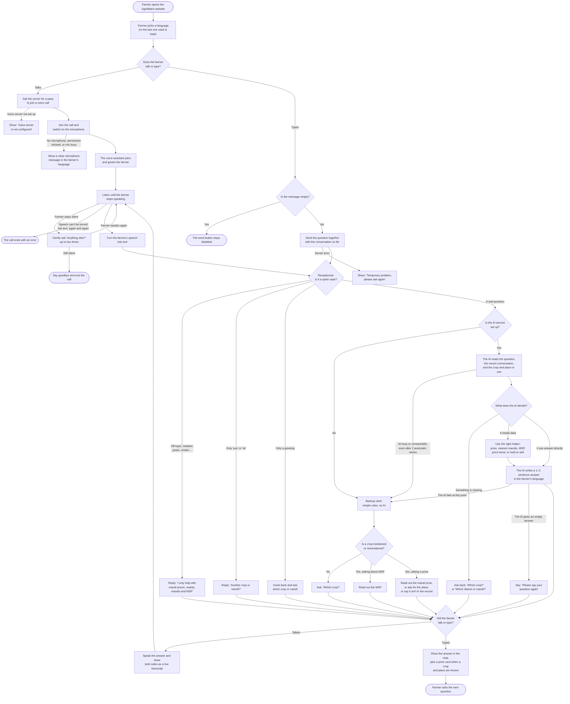

## 2. Each step in detail

### Step 1: Starting a voice call

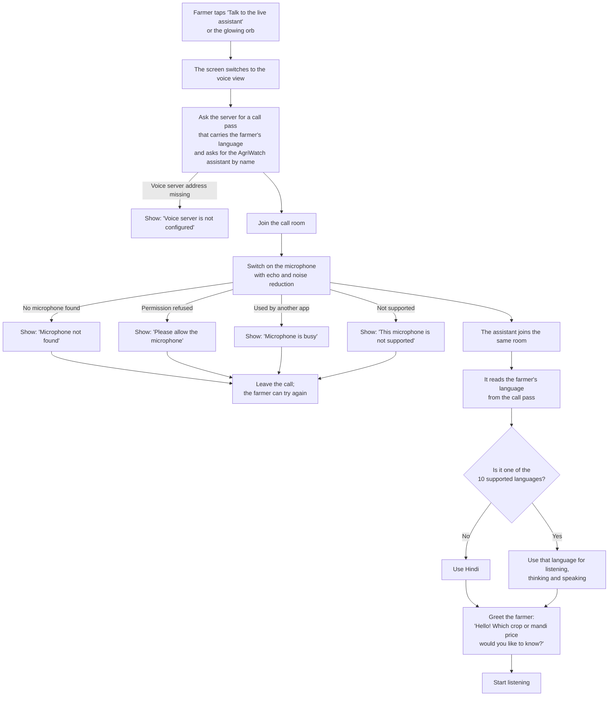

### Step 2: Listening and taking turns

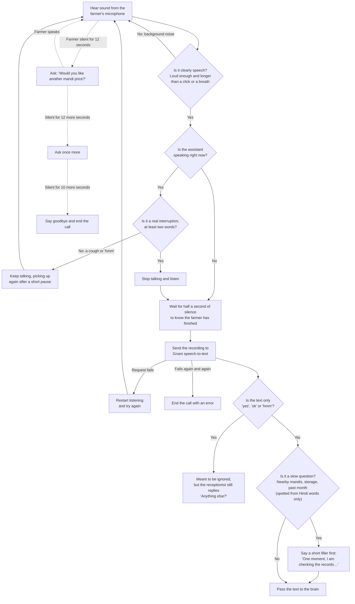

### Step 3: The receptionist (instant replies, no AI)

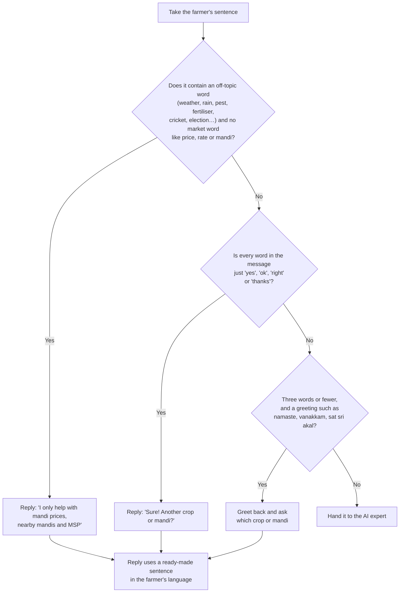

### Step 4: The AI expert

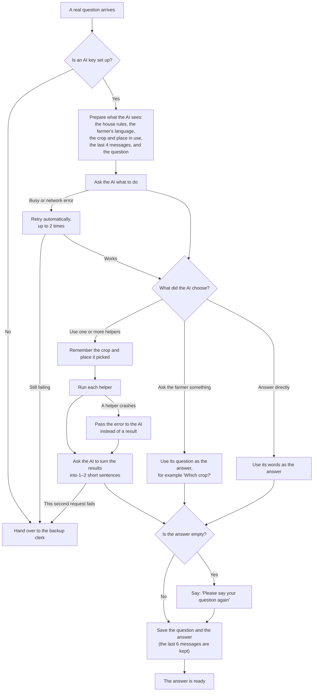

**The house rules the AI is given:**

| Rule | What it means for the farmer |
|---|---|
| Pick the helper by the kind of question | Price, nearby mandis, MSP, trend and storage each have their own helper |
| Answer only what was asked | No MSP or other mandis unless the farmer asks (except the below-MSP warning) |
| Always name the date when a price is not today's | The farmer is never told an old price is today's |
| Never invent a price or a date | If nothing is found, it says so |
| Warn when a price is below MSP | One extra sentence pointing to a government procurement centre |
| Never estimate transport cost or profit | Distances are given, money for the trip is not |
| Pass place and crop names in English | 'இந்தூரில்' is understood as Indore |
| Reply in the farmer's language, 1–2 sentences, no symbols | Short and clear when spoken aloud |

### Step 5: Looking up a price

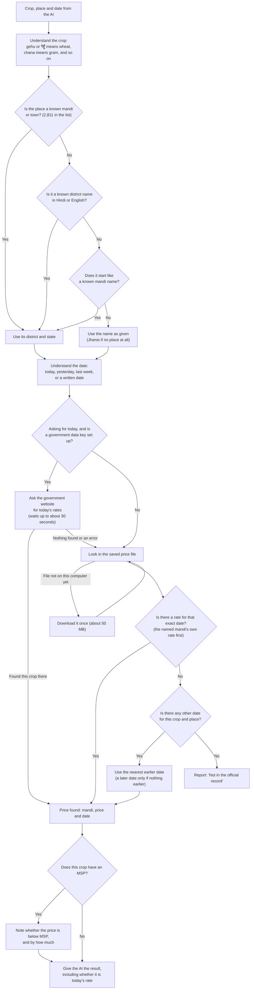

### Step 6: Finding the nearest mandis

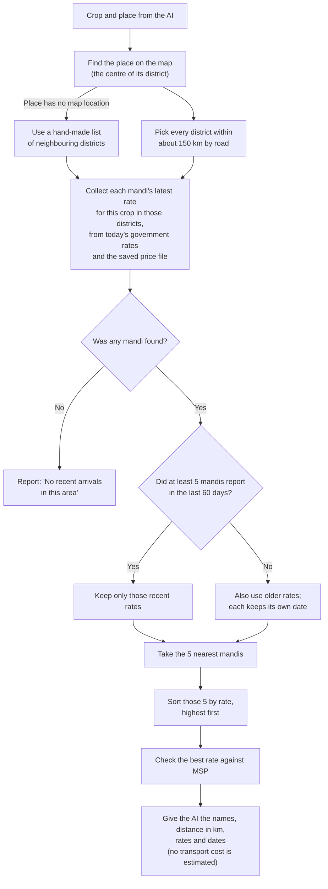

### Step 7: Answering an MSP question

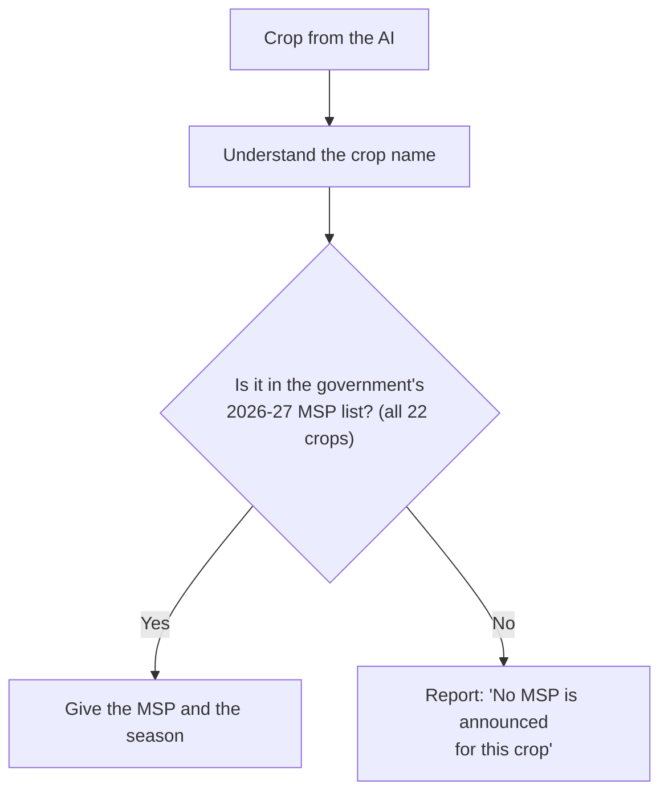

### Step 8: Describing the price trend

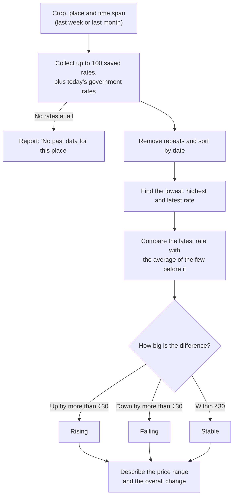

### Step 9: Hold the crop or sell now?

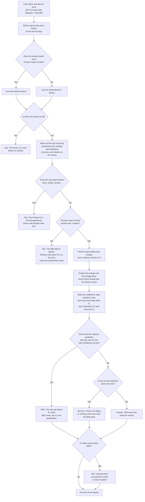

### Step 10: The backup clerk (when the AI is unavailable)

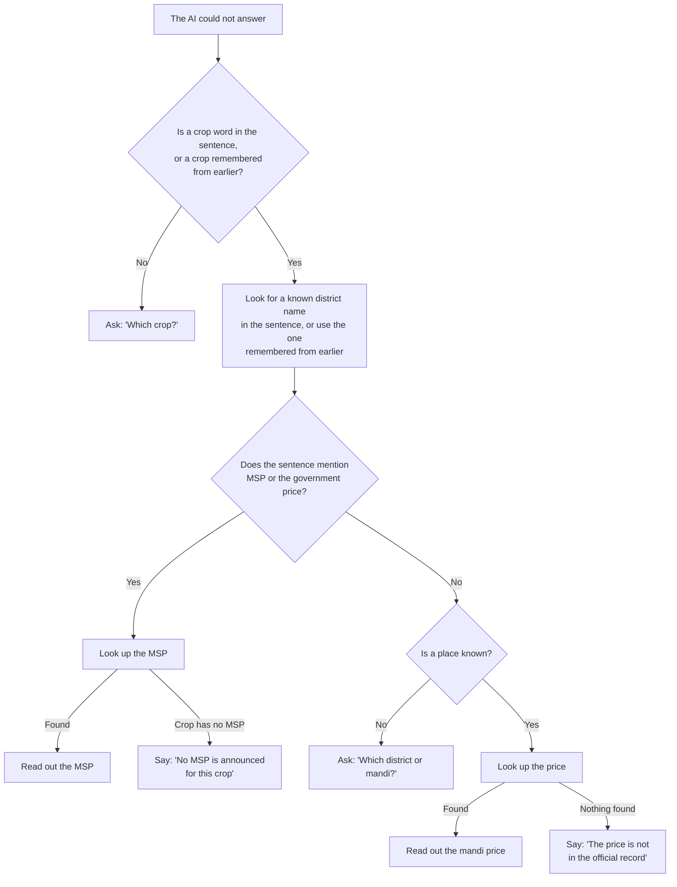

### Step 11: Giving the answer back

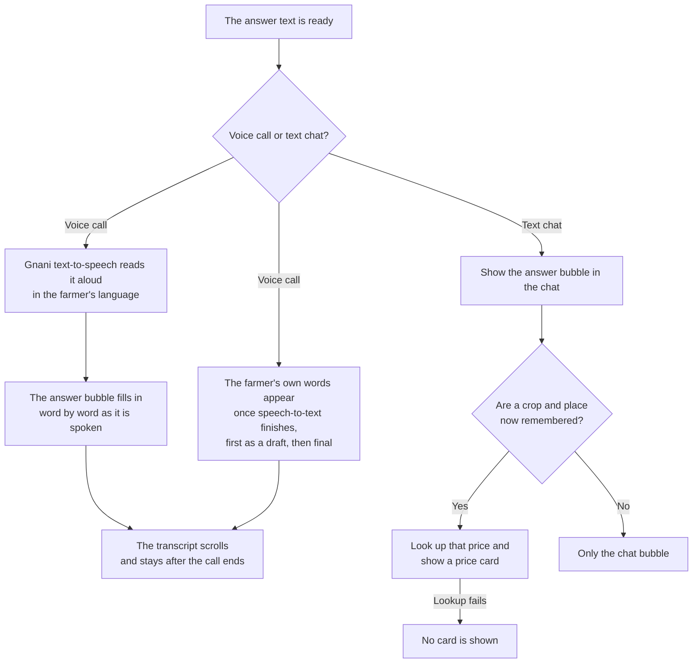

### Step 12: Changing the language

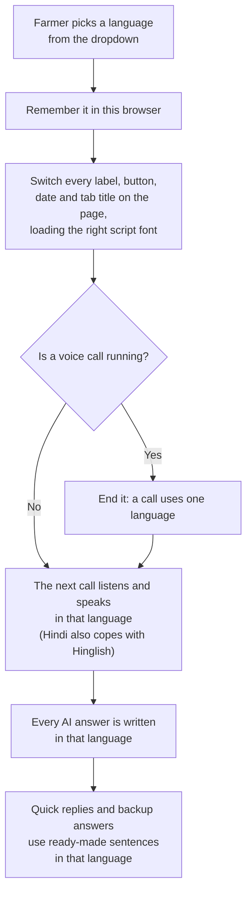

### Step 13: The nightly price update (behind the scenes)

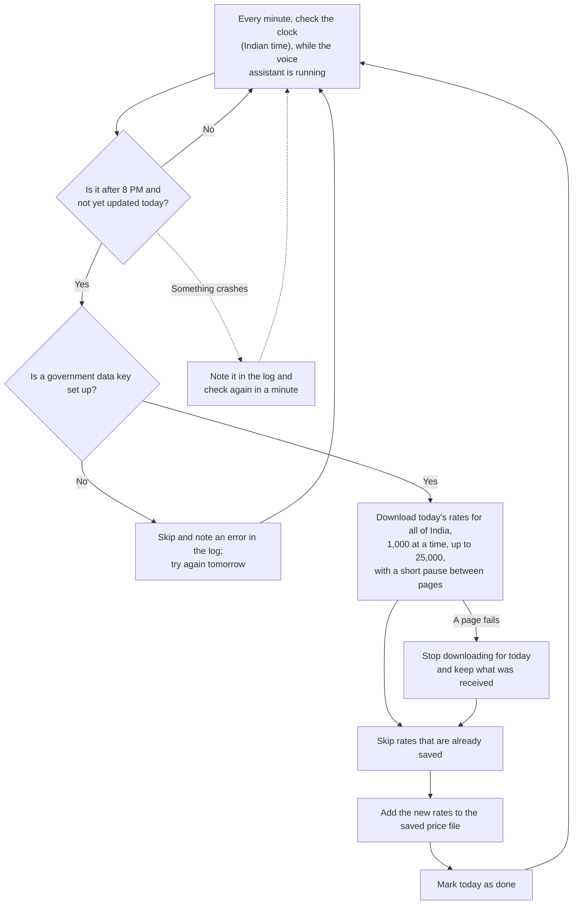

## 3. Why each step is built this way

| Step | What happens | Why | File (optional) |
|---|---|---|---|
| Call pass asks for the assistant by name | The pass names the AgriWatch assistant and carries the language | A named assistant only joins rooms that ask for it, so this is what makes it join | `voice_engine/generate_token.py` |
| Language travels with the call | The assistant reads it when it joins | One setting controls listening, thinking and speaking | `voice_engine/livekit_worker.py` |
| Strict noise filter | Only clear speech counts; half a second of silence ends a turn | Farms and mandis are noisy; stray sounds shouldn't trigger answers | `voice_engine/livekit_worker.py` |
| Interruptions need two words | A cough or 'hmm' doesn't stop the assistant | Natural calls are full of small sounds | `voice_engine/livekit_worker.py` |
| Filler sentence for slow questions | "One moment, checking the records…" | Silence on a call feels like the line dropped | `voice_engine/livekit_worker.py` |
| Silence reminders, then goodbye | Two reminders, then the call ends | Saves credits and doesn't leave calls hanging | `voice_engine/livekit_worker.py` |
| One language code per call for speech-to-text | Never a mix like "English + Hindi" | Gnani rejects mixed codes; the Hindi model already handles Hinglish | `agents/i18n.py` |
| Receptionist before the AI | Greetings, 'ok' and off-topic get instant ready-made replies | Free, instant, and no AI tokens used | `agents/guardrail.py` |
| Short English instructions for the AI | About 630 tokens instead of 2,300 | Hindi text costs about 3x more tokens; this keeps under the 8,000 per minute limit | `agents/llm_reasoner.py` |
| Last 4 messages plus the crop and place in use | The AI remembers "and gram?" means the same place | Follow-up questions feel natural | `agents/llm_reasoner.py` |
| The AI only picks helpers and writes the answer | Numbers come from code, not the AI | AI is good at language, bad at arithmetic and facts | `agents/llm_reasoner.py` |
| Two automatic retries, then the backup clerk | The farmer still gets an answer when the AI is down | A voice call should never just go silent | `agents/graph.py` |
| Backup clerk never guesses | It asks for the place, or says "not in the record", instead of using defaults | A made-up price or the wrong district could cost the farmer money | `agents/fallback.py` |
| Market words override off-topic words | "Will prices rise after the rain?" reaches the AI | Rain and weather often affect prices; blocking them loses real questions | `agents/guardrail.py` |
| 2,811-mandi list and spelling fixes | 'Rath', 'रॉड' and Hindi names are understood | Farmers name their mandi, not the official district | `agents/tools.py` |
| Today's rate from the government website first | Then the saved file, then the nearest earlier date | Freshest data first, but always some honest answer | `agents/tools.py` |
| Always say the date | "Today's rate isn't posted yet; on 24 Sep it was…" | An old price passed off as today's could cost the farmer money | `agents/llm_reasoner.py` |
| Below-MSP check in code | Every price result says whether it is below MSP | The farmer learns they may be underpaid, without asking | `agents/tools.py` |
| Official 2026-27 MSP list | All 22 MSP crops with their government rates | Old MSP figures would give wrong warnings | `data/msp_benchmarks.json` |
| District map locations, worked out once | 560 district centres saved in a file | Lets "nearest mandis" work anywhere in India, not just a few districts | `scripts/build_district_coords.py` |
| 5 nearest, then sorted by rate | No transport cost is shown | Too many unknowns (vehicle, load, tolls) to give a trustworthy cost | `agents/tools.py` |
| Hold-or-sell uses a robust trend and a cautious estimate | One odd report can't flip the advice | Wrong "hold" advice costs the farmer real money | `agents/specialists/economic_advisor.py` |
| Full storage cost, including interest | Rent, handling, crop loss and money tied up | Leaving out interest makes storing look better than it is | `agents/specialists/economic_advisor.py` |
| Spoiling crops and thin data never get "hold" | Onion, potato, tomato; fewer than 6 days of data | No advice is better than confident wrong advice | `agents/specialists/economic_advisor.py` |
| Ready-made sentences in 10 languages | Greetings, reminders and backup answers | These replies don't use the AI, so they need their own translations | `agents/i18n.py` |
| Whole page translated, with script fonts | Labels, dates and tab title switch language | A Tamil farmer shouldn't face a Hindi screen | `frontend/src/i18n.js` |
| Live transcript of both sides | Farmer's words and the answer appear as bubbles | Builds trust: the farmer sees what was heard | `frontend/src/useLiveKitVoice.js` |
| Nightly update at 8 PM | Adds the day's rates for all of India | Mandis post rates during the day; the saved file stays current | `scripts/daily_mandi_sync.py` |

## 4. Every situation

| Situation | What the farmer sees |
|---|---|
| "राम राम" (a greeting) | An instant greeting back, asking which crop or mandi |
| "हाँ ठीक है" ("yes, okay") | "Sure! Another crop or mandi?" |
| "आज मौसम कैसा है?" (weather) | "I only help with mandi prices, nearby mandis and MSP" |
| "झाँसी का भाव बताओ" (place, no crop) | "Which crop would you like the price of?" |
| "चने का भाव?" (crop, no place) | "Please tell me your district or mandi" |
| "झाँसी में गेहूँ का भाव?" when today's rate is posted | Today's rate at that mandi |
| The same question before today's rate is posted | "Today's rate isn't recorded yet; on 24/09 it was ₹2,355" |
| A price below MSP | The price, plus "This is ₹230 below MSP; consider a government procurement centre" |
| A place with no records at all | "The price is not in the official record" |
| "राठ मंडी में चने का भाव" (a small mandi) | The Rath price, without being asked for the district |
| "और गेहूँ का?" ("and wheat?") after asking about Rath gram | Wheat price in Rath: the place is remembered |
| "आसपास की मंडियों के दाम" ("nearby mandi prices") | 5 nearest mandis with km and rates, highest first |
| A place with no map location | Nearby mandis from a hand-made neighbour list, or "no recent arrivals" |
| "गेहूँ का MSP?" (wheat MSP) | ₹2,585 per quintal (2026-27) |
| MSP for a crop without one, like onion | "No MSP is announced for this crop" |
| "भाव बढ़ रहा है या घट रहा है?" ("rising or falling?") | Rising, falling or stable, with the price range |
| "सोयाबीन रोक कर बेचूँ?" ("should I hold my soybean?") with a falling price | "Prices are falling; storing would cost about ₹71 a quintal, so sell now" |
| Storage question for onions | "It spoils quickly; check cold-storage rates first" |
| Storage question with very little data | "Too little data to predict; storing costs about ₹X" |
| "ट्रैक्टर का भाड़ा कितना?" ("how much is tractor freight?") | "I can't estimate transport cost" |
| Question in Tamil, Telugu, Marathi, etc. | The answer in that language, spoken and written |
| Farmer switches language mid-call | The call ends; the next call uses the new language |
| The AI is busy (too many requests) | A short wait while it retries, then an answer from the backup clerk |
| No AI key set | Every real question is answered by the backup clerk |
| Backup clerk, no crop mentioned | "Which crop?" |
| Backup clerk, nothing found | "The price is not in the official record" |
| Backup clerk, MSP for a crop without one | "No MSP is announced for this crop" |
| Backup clerk, place not named and none remembered | "Please tell me your district or mandi" |
| "हाँ, गेहूँ बताओ" ("yes, tell me wheat") | The wheat question is answered normally |
| "हाँ ठीक है" ("yes, okay") on its own | "Sure! Another crop or mandi?" |
| "बारिश के बाद भाव बढ़ेगा?" ("will prices rise after the rain?") | Treated as a market question and answered |
| A cough or "hmm" while the assistant talks | It keeps talking |
| Farmer interrupts with a real sentence | It stops and listens |
| Farmer goes silent | Two gentle reminders, then a goodbye |
| Speech-to-text keeps failing | The call ends with an error |
| Microphone missing, blocked or busy | A clear message in the farmer's language |
| Voice server not configured | "Voice server is not configured" |
| Typed chat fails | "Temporary problem, please ask again" |
| Typed question about a crop and place | The answer plus a price card |
| Government data key missing | Prices come only from the saved file, with their dates |

## 5. Lessons

1. **Let code handle facts and arithmetic, and the AI handle language.** The AI picks a helper and phrases the result; prices, distances, MSP checks and storage costs are all computed in code.
2. **Answer the cheap cases before calling the AI.** A rule-based receptionist handles greetings, "ok" and off-topic questions instantly and for free.
3. **Always have a fallback, and make it honest.** Retries, then a backup clerk, then "please repeat". But a fallback that invents numbers is worse than saying "I don't know".
4. **Say how old the data is.** Every answer names its date. Trust comes from transparency, not from sounding confident.
5. **Only advise when the cautious case still holds.** Hold-or-sell says "hold" only if even the pessimistic estimate pays off, and says nothing confident when data is thin.
