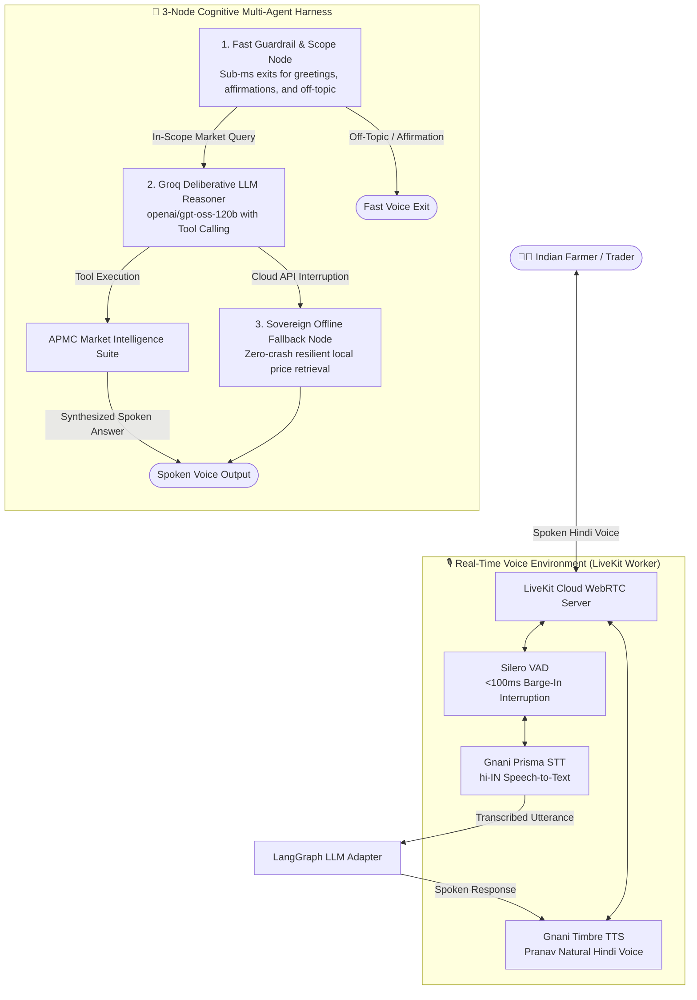

# 🌾 Agri_watch - Sovereign Indic Agricultural Voice Intelligence Agent

[](https://www.python.org/downloads/)
[](https://github.com/langchain-ai/langgraph)
[](https://groq.com/)
[](https://livekit.io/)
[](https://gnani.ai/)

**Agri_watch** is a production-grade, voice-first AI agent designed for Indian farmers and rural traders. It enables effortless, natural Hindi voice interaction over WebRTC to discover **live APMC Mandi wholesale prices**, calculate **multi-mandi transport arbitrage**, analyze **7-day price trends**, and verify **Government MSP (Minimum Support Price) floor protections**.

---

## 🏗️ System Architecture

Agri_watch decouples real-time audio streaming from cognitive deliberative reasoning using an event-driven architecture:



### 🛠️ Market Intelligence Suite (Agent Tools)
1. **`get_crop_price_tool`**: Fetches date-specific APMC modal wholesale rates. If today's rates have not yet been posted by the mandi, it chronologically scans and retrieves the nearest available date.
2. **`compare_mandi_arbitrage_tool`**: Compares commodity rates across multiple APMC markets within a district, adjusting for estimated diesel/freight costs ($\approx ₹35/\text{km}$) to recommend where the farmer will net the highest profit.
3. **`check_msp_floor_tool`**: Looks up official CACP (Commission for Agricultural Costs and Prices) Minimum Support Price floor benchmarks.
4. **`get_crop_price_trend_tool`**: Analyzes 7-day price movement and momentum (Rising, Falling, Stable) to guide whether to sell now or wait.

---

## 📋 Prerequisites

Before setting up Agri_watch, ensure you have:
- **Python**: Version `3.10`, `3.11`, or `3.12` installed.
- **Git**: Installed on your system.
- **API Keys**:
  - [Groq Cloud](https://console.groq.com) (Free account)
  - [LiveKit Cloud](https://cloud.livekit.io) (Free sandbox project)
  - [Gnani.ai](https://gnani.ai) (Indic STT/TTS API key)
  - [data.gov.in](https://data.gov.in) (Open Government Data API key, optional for live auctions)

---

## ⚡ Quickstart Setup ("Setup Skill")

Follow these steps to set up and run Agri_watch on your local machine:

### 1. Clone the Repository
```bash
git clone https://github.com/adi9336/Agri_Watch.git
cd Agri_Watch
```

### 2. Create and Activate a Virtual Environment

**On Windows (PowerShell):**
```powershell
python -m venv .venv
.\.venv\Scripts\Activate.ps1
```

**On Linux / macOS:**
```bash
python3 -m venv .venv
source .venv/bin/activate
```

### 3. Install Required Dependencies
```bash
pip install --upgrade pip
pip install -r requirements.txt
```

### 4. Configure Environment Variables
Copy the `.env.example` template to `.env`:
```bash
cp .env.example .env
```

Open `.env` in any text editor and fill in your keys:
```ini
# Agmarknet / Government Open Data API
API_KEY=your_data_gov_in_api_key_here
DATA_GOV_IN_KEY=your_data_gov_in_api_key_here

# Groq Cloud (Ultra-fast Hindi reasoning)
GROQ_API_KEY=gsk_your_groq_api_key_here
GROQ_MODEL=openai/gpt-oss-120b

# Gnani.ai Indic Speech Engine (hi-IN STT & TTS)
GNANI_API_KEY=your_gnani_api_key_here

# LiveKit Cloud (WebRTC voice environment)
LIVEKIT_URL=wss://your-project.livekit.cloud
LIVEKIT_API_KEY=your_livekit_api_key_here
LIVEKIT_API_SECRET=your_livekit_api_secret_here

# LangSmith Observability (Optional)
LANGSMITH_TRACING=true
LANGSMITH_ENDPOINT=https://api.smith.langchain.com
LANGSMITH_API_KEY=lsv2_pt_your_langsmith_key_here
LANGSMITH_PROJECT=agriwatch
```

---

## 🚀 Running Agri_watch

### Mode 1: Live WebRTC Voice Worker (Recommended)
Connects to your LiveKit Cloud room and listens for real-time voice:
```bash
python voice_engine/livekit_worker.py dev
```

1. Open your browser and go to your **[LiveKit Cloud Console](https://cloud.livekit.io)**.
2. Navigate to **Agents** $\rightarrow$ **Playground**.
3. Select your agent (`agri_watch`), click **Connect**, and start speaking in Hindi!

### Mode 2: Interactive Terminal Console (No Microphone Required)
Test multi-turn text conversations and tool executions without starting LiveKit:
```bash
python voice_engine/interactive_console.py
```

### Mode 3: Direct Mandi Price Discovery CLI
Quickly test Agmarknet data retrieval for any crop and mandi:
```bash
python mandi_tracker.py --crop "चना" --district "कटनी" --date "पिछले हफ्ते"
```

---

## 🧪 Running Automated Tests

Run the full end-to-end LangGraph unit test suite:
```bash
python -m unittest tests/test_langgraph_pipeline.py
```

All 6 integration tests will verify:
- ✅ Fast-path greeting and affirmation handling
- ✅ Off-topic guardrail routing
- ✅ Single-entity disambiguation (asking for missing crop/district)
- ✅ Date-aware price discovery with nearest-date resolution
- ✅ Transport-adjusted multi-mandi arbitrage
- ✅ MSP floor protection queries

---

## 💡 Key Design & Conversational Intelligence

- **Spoken-First Conciseness**: LLM output is strictly limited to **1 to 2 short sentences**, formatted without markdown characters (`**`, `#`, bullets) or emojis so TTS engines pronounce numbers and currency cleanly.
- **Pan-India District Resolution**: Transparently recognizes mandis across state borders (e.g., *Katni*, *Jabalpur*, *Indore*, *Jhansi*, *Agra*, *Kota*).
- **In-Session Entity Continuity**: Maintains session memory across turns. If you ask about *"चना in लखनऊ"* and follow up with *"और गेहूं का भाव क्या था?"*, it seamlessly retains Lucknow without asking for your district again.
- **Autonomous Fallback**: If cloud connectivity is lost, the sovereign fallback node answers with locally cached market data to prevent dropping calls with farmers.

---

## 📂 Project Directory Structure

```text
Agri_watch/
├── agents/                     # LangGraph Multi-Agent Cognitive Harness
│   ├── fallback.py             # Sovereign offline fallback node
│   ├── graph.py                # StateGraph orchestration & conditional edges
│   ├── guardrail.py            # Scope, greeting, and affirmation guardrail
│   ├── llm_adapter.py          # LiveKit Agents v1.8+ LLM adapter
│   ├── llm_reasoner.py         # Groq LLM tool calling and synthesis node
│   ├── observability.py        # LangSmith tracing wrappers
│   ├── state.py                # AgentState TypedDict schema
│   └── tools.py                # LangChain market intelligence tool suite
├── data/
│   ├── mandi_prices_snapshot.csv # 50MB APMC Agmarknet snapshot (auto-downloaded)
│   └── msp_benchmarks.json     # Official CACP MSP floor price benchmarks
├── tests/
│   └── test_langgraph_pipeline.py # Comprehensive integration unit tests
├── voice_engine/               # LiveKit Supporting Audio Environment
│   ├── interactive_console.py  # Text-based interactive testing harness
│   ├── livekit_worker.py       # LiveKit WebRTC worker with Silero VAD & Gnani
│   ├── gnani_speech.py         # Gnani STT and TTS client definitions
│   └── generate_token.py       # LiveKit room access token generator
├── mandi_tracker.py            # APMC Agmarknet data retrieval & date resolver
├── requirements.txt            # Python dependencies
├── .env.example                # Configuration template
└── README.md                   # Project documentation
```

---

## 🤝 Contributing & License
Contributions, feedback, and pull requests are welcome. Distributed under the MIT License.
